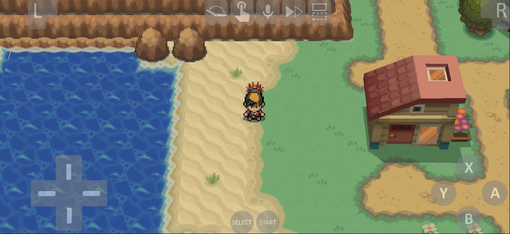
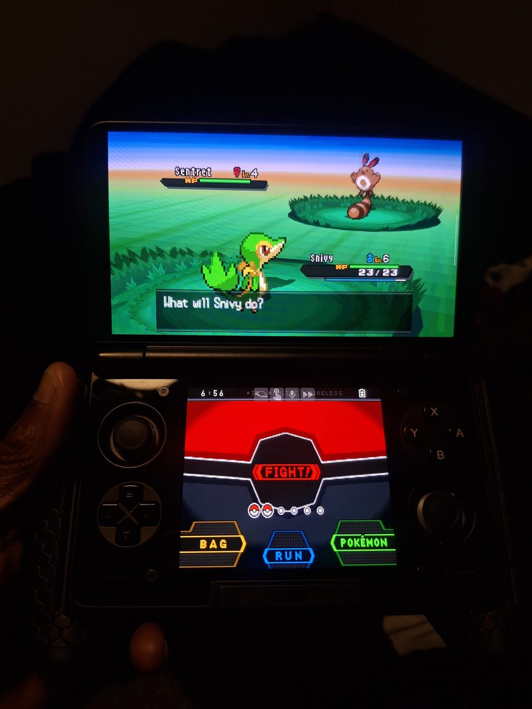

<p align="center">
  
</p>

<h1 align="center">WideMelon for Android</h1>

<p align="center">
  Play DS games without the black bars.
  <br>
  <a href="https://github.com/pruefsumme/widemelon-android/releases/latest">Download</a> ·
  <a href="https://github.com/pruefsumme/widemelon-android/releases/tag/nightly">Nightly</a> ·
  <a href="https://github.com/pruefsumme/widemelon">Desktop version</a>
</p>

WideMelon draws the 3D in DS games wider, so the top screen fills your display instead of sitting in a 4:3 box. Menus,
text and the HUD keep their normal size. It works for any 3D game, no widescreen cheats or patches needed.

It's the Android version of [WideMelon](https://github.com/pruefsumme/widemelon), built on WatermelonDS and
[melonDS](https://melonds.kuribo64.net/).

## Getting started

<p align="center">
  
  <br>
  <sub>On a phone</sub>
</p>

Install the APK from the [releases page](https://github.com/pruefsumme/widemelon-android/releases/latest), pick your
ROM folder and start a game. Widescreen is on by default.

WideMelon installs next to melonDS and WatermelonDS, it doesn't replace them. The nightly installs next to the stable
version too.

## Settings worth knowing

- **Renderer:** widescreen only works with OpenGL, which is the default. Vulkan and the others stretch the picture or
  keep 4:3. A game can also have its own renderer set under *ROM Config & Details*, which overrides the global one.
- **Width:** *Auto* matches your screen. 16:9, 21:9 and a custom width are there too, but anything wider than your
  screen adds black bars.
- **Bottom screen:** tap the toggle button in game, or map *Toggle Bottom Screen* to a controller button. It can
  replace the top screen, float in a corner or sit beside it.
- **Two screens:** on handhelds like the AYN Thor the bottom screen goes on the second display by itself.
- **Black lines in Pokémon maps:** turn on *Settings › Video › Conservative coverage fix*.

Everything widescreen related is in *Settings › WideMelon*, and in game under *Widescreen & Screens*.

## Good to know

- DS games were made for 4:3. Some don't draw anything past those edges, so you might see empty sides, things popping
  in or flicker. If a game looks wrong, turn widescreen off for it.
- **Photosensitivity warning:** flicker can trigger seizures in people with photosensitive epilepsy. If a game
  flickers, turn widescreen off.
- Scenes without any 3D keep black bars, there's nothing to widen.
- Hardcore RetroAchievements always runs at the normal width so it stays fair.

Everything else from WatermelonDS is still here: RetroAchievements, shaders, the layout editor, DSiWare and more.

<p align="center">
  
  <br>
  <sub>On an AYN Thor, photo by <a href="https://github.com/darreoncollins">@darreoncollins</a></sub>
</p>

## Launching from a frontend

For ES-DE, Daijishō and similar:

- Package: `io.github.pruefsumme.widemelon` (nightly: `io.github.pruefsumme.widemelon.nightly`)
- Activity: `me.magnum.melonds.ui.emulator.EmulatorActivity`
- Data: the ROM URI (ZIP and 7z work), with read permission

Let WideMelon scan the ROM folder first, otherwise saves end up in
`Android/data/io.github.pruefsumme.widemelon/files/saves`.

## Building

You need the Android SDK with NDK `28.0.13004108` and CMake, JDK 21, and Rust from [rustup](https://rustup.rs/).

```sh
git clone --recurse-submodules https://github.com/pruefsumme/widemelon-android.git
cd widemelon-android
./gradlew :app:assembleGitHubProdDebug
```

The APK lands in `app/build/outputs/apk/gitHubProd/debug`. Run `./gradlew :app:verify` before pushing, it does the same
checks as CI. `git config core.hooksPath .githooks` runs it on every push.

For signed builds, add `MELONDS_KEYSTORE`, `MELONDS_KEYSTORE_PASSWORD`, `MELONDS_KEY_ALIAS` and `MELONDS_KEY_PASSWORD`
to `local.properties`.

The widescreen changes to the emulator core live in
[pruefsumme/melonDS-android-lib](https://github.com/pruefsumme/melonDS-android-lib) on the `widemelon` branch.

## Credits

- [melonDS](https://github.com/melonDS-emu/melonDS) by Arisotura and contributors
- [melonDS Android](https://github.com/rafaelvcaetano/melonDS-android) by rafaelvcaetano
- [WatermelonDS](https://github.com/SapphireRhodonite/WatermelonDS) by SapphireRhodonite
- [librashader](https://github.com/SnowflakePowered/librashader) and [rcheevos](https://github.com/RetroAchievements/rcheevos)
- AYN Thor photo by [darreoncollins](https://github.com/darreoncollins)

Licensed under the GPLv3, like melonDS.
